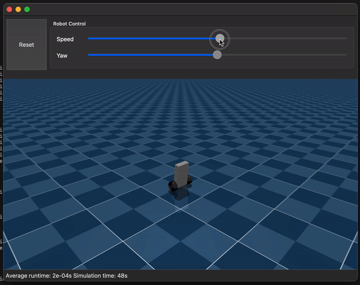

# Self balancing robot simulation in MuJoCo

## What / Why
Simulation of a two wheeled self balancing robot, this time using [MuJoCo](https://mujoco.org/). The robot uses a Linear–quadratic regulator (LQR) controller to maintain balance. In this example the MuJoCo simulation view is embedded in a Qt application (PySide6) to provide UI widgets for controlling the robot. 

After implementing the same simulation using PyBullet (see [here](https://github.com/lachlanhurst/balance-robot-pybullet-sim)), I found that PyBullet support for [Stable-Baselines3](https://stable-baselines3.readthedocs.io/) / [Gymnasium](https://gymnasium.farama.org/index.html) was a little lacking. It made sense to switch to MuJoCo given how early on this project is.




## Setting up the development environment

Clone the repo

    git clone https://github.com/lachlanhurst/balance-robot-mujoco-sim.git
    cd balance-robot-mujoco-sim

It's recommended to use the conda environment file included in this repository; these commands will create and activate a new `robot-mujoco-simulation` conda env.

    conda env create -f conda-environment.yaml
    conda activate robot-mujoco-simulation


## Calculating LQR parameters

The LQR parameters are already [included in the source code](./src/simulation/robot_lqr.py). There is no need to re-calculate these parameters unless the physical characteristics of the robot change (as defined in [`robot-02.xml`](./src/simulation/robot-02.xml)).

If you do need to re-calculate these parameters follow the process defined in the [PyBullet simulation repo](https://github.com/lachlanhurst/balance-robot-pybullet-sim).


## Running the simulation

The following command will run the simulation. Note: the `robot-mujoco-simulation` must be activated

    python src/simulation/simulate_robot.py


## INT8 neural control

Install `requirements-int8.txt`, then select **NN INT8** in the GUI to execute
`models/ROBOT.TFL` with its matching `ROBOT.json` normalization metadata.
The existing **Neural Network** mode retains the original FP32 weights.
The 4→16→16→1 INT8 model uses 336 MACs and 2,768 bytes; it completed all 18
ordinary 20-second evaluation episodes, as did FP32. Pitch RMS increased.
An equivalent ReLU graph, `ROBOTFC.TFL`, uses the existing PSC-ONE operator profile.
See the [INT8 validation report](docs/int8-validation.md) for full metrics,
stress failures, runtime compatibility limits, and reproduction commands.

## AUTO command mode

Select **AUTO** in **Robot Control → Command mode** to run the displayed robot
without moving the Speed/Yaw sliders. It works with LQR, a loaded Neural Network,
or a loaded Reinforcement Learning controller. Startup remains **MANUAL**.

AUTO cycles the nine training command patterns (stopped, gentle forward/reverse,
stepped speed, forward-stop-reverse, left/right turns, combined speed/yaw, random
commands). Each episode lasts up to 8 simulation seconds. A tilt over 45° in any
direction or an invalid physics state resets the robot and advances to the next
pattern. The cycle repeats until MANUAL is selected. Speed is limited to ±0.6 m/s
and yaw to ±2 command rad/s, with smooth changes at 200 Hz. The panel shows the
episode, pattern, elapsed time, fall count and applied commands; sliders display
the commands and are disabled for manual input.

Entering AUTO resets the robot near upright. **Reset** keeps AUTO and the selected
controller, restarts the pattern sequence and clears the fall count. Switching
controllers preserves the current episode. Returning to MANUAL sets both commands
and sliders to zero and restores manual input without resetting physics.

NN and RL **training already generate their own commands automatically** in
separate simulations. Use **Train NN**, **Train new RL** or **Continue loaded RL**
to learn and save a model; training can run alongside AUTO. The displayed AUTO
run evaluates the active model and does not update its weights. In RL training,
`balance` holds zero target speed and `velocity` generates forward/reverse targets;
yaw remains zero. AUTO turns are a playback test, not learned RL turning.

## Acknowledgements

[Jean Elsner](https://github.com/JeanElsner) put together this [great simple example](https://gist.github.com/JeanElsner/755d0feb49864ecadab4ef00fd49a22b) on how to embed a MuJoCo simulation within a PySide6 application.


## Neural Network controller

LQR remains the startup default. The Controller selector switches between **LQR**
and **Neural Network**, with an additional **Reinforcement Learning** option
described below, without resetting the physics. LQR and supervised NN both use
the original 200 Hz controller, 0.975/0.025 filters, `MAX_MOTOR_VEL = 500 rad/s`,
and the same yaw mixing (`left = -velocity + yaw`, `right = velocity + yaw`).
Reset preserves the selected controller and clears its filters, commands and time.
Simulation, scene preparation, Reset and controller replacement share one lock.

### Installation and GUI

From `balance-robot-mujoco-sim`, in the existing Python environment:

```bash
python -m pip install -r requirements-nn.txt --index-url https://download.pytorch.org/whl/cpu
python -B src/simulation/simulate_robot.py
```

The provided `models/robot_nn.npz` enables NN selection immediately. LQR still
works if PyTorch or the model is absent; NN selection stays disabled until a valid
model is available. A damaged model is reported in the training panel without
preventing LQR startup. PyTorch is needed only for training. NN control evaluates
an equivalent NumPy export of the trained MLP, so no optimizer, model loading or
PyTorch thread pool runs in the simulation loop.

Click **Train NN** in the right sidebar's **Supervised NN** tab. Episodes and Epochs can be changed there
(defaults: 120 / 240). The panel displays Idle / Collecting Data / Training /
Validation / Saving Model / Completed (or Failed), collection progress, sample count, epoch count, training /
validation / best validation loss, learning rate, elapsed time and a live loss
plot. It also shows Current Episode / Total Episodes, Current Auto Speed/Yaw
Command, Current Scenario, episode simulation elapsed time and Number of falls.
Auto command values are shown only while collecting. Loss is physical MSE in `(rad/s)^2`; the plot uses a logarithmic vertical
axis. The sidebar scrolls on smaller displays.

Training runs in a separate process with its own MuJoCo model/data and one CPU
training thread. Progress is received asynchronously and labels refresh at 10 Hz.
The displayed simulation can continue, switch controllers and Reset during
training. Completion saves the model and loads it; if NN is already selected,
the new weights replace the old predictor under the simulation lock. Otherwise
LQR stays selected. Failed training leaves the active predictor intact. Closing
the application stops simulation and terminates any running training process.

### Data and training

```bash
python -B src/simulation/neural_training.py --episodes 120 --duration 8 --epochs 240 --seed 42
```

Each 5 ms control tick records, in this order:

1. Controller pitch (radians, same sign as LQR).
2. Filtered pitch rate (rad/s).
3. Filtered forward-positive wheel angular velocity (rad/s).
4. Target linear velocity (m/s).

The target is the actual limited LQR motor velocity **before yaw mixing**,
measured as `(right_motor_command - left_motor_command) / 2`. Sensors/filters are
sampled once per tick. The original physics timestep is unchanged (25 microseconds,
200 physics substeps per control tick). Offline collection/evaluation schedules
control ticks in simulation time. The GUI now also schedules every 200 physics
steps; wall time only paces the displayed simulation. Slow rendering cannot
change the control period or the filters' effective simulation-time rate.

**Train NN** performs automatic LQR collection → training → held-out Validation →
model saving/loading without slider input. Automatic commands belong exclusively
to the independent training simulation. Speed/Yaw sliders, controller selection,
and Reset continue to control the displayed simulation as before, even while
training is running.

Nine scenarios cycle through stopped, gentle forward, gentle reverse, stepped
speed, forward → stop → reverse, left turn, right turn, simultaneous speed/yaw,
and random commands. Targets are held for 0.5–3 seconds of simulation time,
never randomized each control tick. Applied commands slew from zero at at most
0.15 m/s per second (Speed) and 1.0 command rad/s per second (Yaw). The reversal
scenario holds each target for 2 seconds, including a real zero-command dwell.
The last hold can be cut short by episode completion or a fall.

The GUI ranges remain ±4 m/s and ±10 yaw-command rad/s. Automatic training uses
a conservative subset: Speed ±0.6 m/s and Yaw ±2 rad/s, with gentle forward/reverse
at 0.15–0.3 m/s. Yaw is the existing wheel mixing command, not measured body yaw
rate. These limits and slew rates are defined in `src/simulation/auto_commands.py`.

Every episode resets MuJoCo and all teacher filters, starts commands/velocities
at zero, and draws seeded small initial tilts (pitch ±0.08 rad, roll ±0.03 rad)
and a random heading. A body tilt exceeding 45° in any direction ends the episode
immediately; collection resets and advances automatically. Falls are counted.
Defaults are 120 episodes of up to 8 seconds. At least 18 episodes (two per
scenario) and 6 seconds per episode are required to cover each pattern and keep
training/validation episodes separate. Total Episodes is the fixed attempt budget;
falls may shorten attempts.

After collection, complete episodes are assigned to training or validation
separately for each scenario (approximately 20% held out, minimum one per scenario).
Each split is then randomly downsampled across full trajectories to the smallest
scenario sample count, so all nine patterns have exactly equal representation
within each split, even after falls. No samples are duplicated. Collected samples
in the GUI counts raw samples; the report distinguishes collected and retained
counts and lists every scenario's training/validation counts. This may discard
some samples from longer episodes to prevent stopped-only bias.

The PyTorch MLP is `4 → 16 → 16 → 1`, with LeakyReLU(0.1) hidden activations.
Input mean/std and output mean/std are fitted only on training episodes. Twenty
percent of entire episodes are held out per scenario (at least one), avoiding leakage from
neighboring time samples. Training uses Adam with cosine learning-rate decay for
75% of epochs, then full-batch LBFGS refinement. The checkpoint with the lowest
validation MSE is saved, not necessarily the final epoch. All random seeds are
fixed; no evaluation scenarios are used to fit normalization or weights.

Generated files (use `--output /path/name.npz` to change the destination):

| File | Contents |
| --- | --- |
| `models/robot_nn.npz` | Inference weights, feature order, activation and input/output normalization; atomically replaced |
| `models/robot_nn.pt` | PyTorch state dict, architecture and the same normalization; load with `torch.load(..., weights_only=True)` |
| `models/robot_nn.data.npz` | Inputs, actual targets, episode IDs, validation mask, scenario names, applied/target Speed+Yaw commands and episode simulation times |
| `models/robot_nn.training.json` | Configuration, sample ranges, split, losses, scenario counts, falls, initial states/command schedules and per-epoch history |

### Evaluation and regression checks

```bash
python -B src/simulation/evaluate_controllers.py --duration 10
python -B -m unittest discover -s tests -v
python -B tests/gui_neural_smoke.py  # requires a working desktop/OpenGL display
```

Evaluation runs LQR and NN independently with identical initial states, target
schedules, yaw and physics/control timestep. Ten scenarios cover static balance,
gentle forward/reverse ramps, abrupt forward/reverse commands, direction changes,
turning and high-speed commands. It writes `models/robot_nn.evaluation.json` and
prints a summary. `--model` and `--output` can select other models/report paths.

Metrics are balancing time until `|pitch| > 45°` (capped at the requested duration),
RMS pitch, maximum absolute pitch, RMS velocity error using raw forward-positive
wheel velocity times wheel radius, and NN/LQR motor-output RMSE. Output error is
computed on the **same input state** along each controller's trajectory, after
limiting and before yaw. Each scenario is measured only until its first fall;
short failing runs must not be interpreted as successful tracking. Summary values
are unweighted scenario means, except maximum pitch is the global maximum.

### Recorded comparison (2026-10-04)

Tested with MuJoCo 3.14.0, PyTorch 2.14.1+cpu, NumPy 2.5.3.
This historical comparison predates the automatic command scheduler. The supplied model uses seed 42, 120 episodes, 240 epochs and 31,279 samples
(23,309 training / 7,970 validation).
Best held-out validation MSE: 0.00061106 (rad/s)^2;
RMSE: 0.02472 rad/s. Training took 35.5 seconds on this machine.

| Metric (10 scenarios, 10 s cap each) | LQR | Neural Network |
| --- | ---: | ---: |
| Mean balancing time [s] | 5.51100 | 5.51100 |
| Mean RMS pitch [deg] | 6.26694 | 6.26602 |
| Maximum absolute pitch [deg] | 46.49749 | 46.49762 |
| Mean velocity tracking RMSE [m/s] | 0.59290 | 0.59280 |
| Mean NN/LQR output RMSE on that trajectory [rad/s] | 0.01698 | 0.01745 |
| Falls / 10 | 6 | 6 |

| Scenario | LQR balance [s] | NN balance [s] | LQR RMS pitch [deg] | NN RMS pitch [deg] |
| --- | ---: | ---: | ---: | ---: |
| balance-positive | 10.000 | 10.000 | 2.193 | 2.197 |
| balance-negative | 10.000 | 10.000 | 2.162 | 2.162 |
| gentle-forward | 10.000 | 10.000 | 1.996 | 1.996 |
| gentle-reverse | 10.000 | 10.000 | 1.996 | 1.988 |
| forward | 0.210 | 0.210 | 15.608 | 15.615 |
| reverse | 0.210 | 0.210 | 15.608 | 15.608 |
| forward-reverse | 2.625 | 2.625 | 7.310 | 7.308 |
| turning | 5.155 | 5.155 | 6.818 | 6.809 |
| fast-forward | 3.455 | 3.455 | 4.489 | 4.489 |
| fast-reverse | 3.455 | 3.455 | 4.489 | 4.489 |

Static balance and gentle forward/reverse ramps complete all 10 seconds for both
controllers. Six aggressive scenarios cause both controllers to fall; this is
a limitation of the existing teacher under those commands, not evidence of
general NN robustness. This model imitates LQR and has not been validated
for physical hardware. The detailed JSON includes every per-scenario metric.

Validation also included exact old/new LQR equality across 1,000 control ticks
(motor commands, status snapshots, qpos and qvel), the Reset regression suite,
PyTorch/export equivalence, NN limits/yaw, episode split checks and real GUI
training with repeated controller switches and Resets.

## Reinforcement Learning (PPO)

RL is a separate controller using Stable-Baselines3 PPO and small Tanh MLPs
(`7 → 32 → 32 → 1` policy mean, and `7 → 32 → 32 → 1` value network).
New training uses random weights and reward only: it never calls LQR for labels
or imports the supervised NN weights. The original NN `.npz`/`.pt` formats and
LQR equations/filters are unchanged. The bundled `models/robot_rl.rl.zip` is a
balance-stage checkpoint selected at 501,760 steps. On 2026-10-08 it completed
four seeded 60-second balance trials without falling. Final-half speed RMS was
about 0.0175 m/s: it still drifts and does not pass the stricter displacement-based
stopping check in `evaluate_rl.py`. Driving has not been trained. The original
100,352-step model (652 falls in 652 training episodes) is preserved as
`models/robot_rl.before-balance-fix.rl.zip`. A later 602,112-step candidate fell
after 15–21 seconds and was rejected. See
[`docs/rl-balance-fix-validation.json`](docs/rl-balance-fix-validation.json).
Restart the app, use **Load RL** to load `models/robot_rl.rl.zip`, select
**Reinforcement Learning / MANUAL**, set Speed/Yaw to zero, and press **Reset**.

### Install, train, evaluate and run

Use the existing MuJoCo/NumPy/SciPy/PySide6 environment above. RL additionally
requires Gymnasium, Stable-Baselines3 and PyTorch; CPU execution is sufficient.
From `balance-robot-mujoco-sim`:

```bash
python -m pip install -r requirements-rl.txt
# Stage 1: learn to stand with zero target speed; evaluate before progressing.
python -B src/simulation/rl_training.py --stage balance --steps 1000000 \
  --config config/rl-default.json --output models/rl-balance.rl.zip
python -B src/simulation/evaluate_rl.py --rl-model models/rl-balance.rl.zip \
  --rl-only --duration 8 --output models/rl-balance.evaluation.json
# Stage 2: restore PPO/optimizer state, then introduce forward/reverse targets.
python -B src/simulation/rl_training.py --resume models/rl-balance.rl.zip \
  --stage velocity --steps 1000000 --output models/robot_rl.rl.zip
# Same initial poses, rates, targets, yaw, timestep and fall threshold for all 3.
python -B src/simulation/evaluate_rl.py --rl-model models/robot_rl.rl.zip \
  --nn-model models/robot_nn.npz --duration 8 --output models/rl-evaluation.json
python -B src/simulation/simulate_robot.py
```

Step budgets are examples, not convergence guarantees. `--steps` counts additional
**control steps**, not physics substeps, and PPO rounds up to full rollouts
(default 2,048 steps). `--rollout-steps` accepts multiples of 64 for smoke tests.
PPO defaults here: batch 64, 10 optimization epochs/rollout, learning rate 0.0003,
discount 0.999, GAE lambda 0.98, initial log standard deviation −2, seed 42,
one CPU thread. Initial exploration is about 4 rad/s instead of 30 rad/s.
CLI stdout emits JSON progress.
Ctrl-C/SIGTERM requests stop/save at the next callback. There is no rendering or
real-time sleep in training or evaluation. The reference implementations are
[SB3 PPO](https://stable-baselines3.readthedocs.io/en/master/modules/ppo.html) and
[Gymnasium termination/truncation](https://gymnasium.farama.org/tutorials/gymnasium_basics/handling_time_limits/).

In the **RL (PPO)** tab:

- **Train new RL** starts randomly; choose `balance` or `velocity` and the step budget.
- **Continue loaded RL** resumes the exact loaded snapshot and uses the selected stage.
- **Stop and save** stops cooperatively and writes a bundle. **Training output…**
  chooses the destination before starting (default `models/robot_rl.rl.zip`).
- **Load RL** validates and loads a saved bundle. **Save loaded RL as…** copies
  that exact snapshot, including its training state, to another file.
- Total steps, completed episodes, mean episode return/duration over the last
  100 completed episodes, cumulative falls/invalid episodes, and control steps/s
  describe the training run (including restored history on continuation).
  The loaded model's own step count is also shown in the message.

Exhausting the step budget is **not** evidence that the robot can balance.
Training now ends with `Evaluating`, followed by `Validated` or `Needs training`.
Four held-out seeds run the deterministic policy for at least a full episode
(minimum 30 seconds to catch delayed falls, extended when needed for a speed ramp and stop). Every trial must finish without falling, with final-half speed
RMS below 0.02 m/s and peak below 0.05 m/s. Velocity-stage validation also runs
four moving-target trials requiring no falls and tracking RMSE below 0.08 m/s.
The bundle stores these results and the GUI displays **Saved policy validation**.
Stopped runs and old bundles without results are **Not evaluated**. Passing is
limited to these conditions; yaw and arbitrary live controller switches are
not covered. A failed validation still saves the checkpoint for continuation.
Use **Continue loaded RL** with `balance` until validation passes; **Train new RL**
restarts from random weights. Test in **MANUAL**, set Speed/Yaw to zero, and press
**Reset** before running the policy. AUTO sends driving commands even for a
balance-only policy.

The GUI always starts in LQR. RL is disabled until a bundle is successfully
loaded; RL files are not loaded automatically on startup. Successful training or
stop/save loads a fresh snapshot but leaves the current controller selection
unchanged. If RL is selected, replacement occurs under the simulation lock.
Training has an independent MuJoCo model/data in a `QProcess`; progress arrives
through Qt signals. Loading runs in a `QThread`, also returning via signals.
An active predictor never shares weights with the learner. Failed training or
loading retains the previous predictor. Closing requests cooperative training
stop/save and waits; an unresponsive child is terminated/killed after timeouts.
Forced termination may lose the current run, but atomic writes preserve the
previous complete bundle. Reset, Speed (±4 m/s), Yaw (±10 command rad/s), and
control status remain available. Reset preserves the selected controller.

### Physics, action and timing contract

Training uses the **unmodified** `src/simulation/scene.xml` and `robot-02.xml`,
with independent `MjModel`/`MjData`. The scene's 25 µs timestep divides the
5 ms control period exactly: **200 physics steps per action, 200 Hz**. GUI,
RL and offline controllers share the period validation in `control_timing.py`.
GUI control begins at simulation time zero and counts physics steps. Training
and evaluation advance 200 steps at a time without a wall-clock dependency.

The XML actuators are `<velocity gear="1" kv="0.9">`: `ctrl` is an **absolute
joint angular velocity target in rad/s**, not torque and not a velocity increment.
The joint actuator force range ±5 bounds actuator torque (N·m for these hinges);
it does not set the velocity command range. The existing common command limit
is ±500 rad/s. A PPO scalar action `a` is clipped to `[-1, 1]`, then converted to
`v = 30 * a` rad/s by default. `action_scale` can be tuned up to 500. The smaller
initial exploration range does not alter the LQR/NN limit.

All controllers use the original mixing: `left = -v + yaw`, `right = v + yaw`.
Common-command limiting happens **before** yaw mixing, so a final wheel command
may exceed ±500 by the yaw offset, exactly as before. The wheels have opposite
joint axes. Positive forward wheel speed is `(-left_qvel + right_qvel)/2`, wheel
radius is 0.034 m, and body forward is local **−Y**. Yaw remains a manually mixed
wheel command, not a learned body yaw rate. RL training uses yaw zero.

### Observation and normalization

`rl_control.py` is the single observation/action implementation for the Gym
environment and GUI `RobotRL`. RL uses raw sensors, not the LQR/NN low-pass
filters. Let `R` be the body-to-world rotation matrix and `qvel_xyz` the world
linear velocity of the free joint. Observations have this exact order:

| Index | Quantity | Raw unit / definition | Fixed divisor |
| --- | --- | --- | ---: |
| 0 | Controller pitch | rad; `-atan2(R[2,1], R[2,2])` | 0.35 |
| 1 | Pitch-axis angular velocity | rad/s; free joint local angular X, opposite the pitch derivative near upright | 5 |
| 2 | Forward wheel speed | m/s; `(-left_qvel + right_qvel) * 0.034 / 2` | 1 |
| 3 | Actual body forward speed | m/s; `-dot(qvel_xyz, R[:,1])` | 1 |
| 4 | Target forward speed | m/s | 1 |
| 5 | Previous applied common action | dimensionless; previous `v/action_scale`, zero on reset | 1 |
| 6 | Side tilt | rad; `atan2(R[2,0], R[2,2])` | 0.35 |

Each raw feature has zero mean subtraction, is divided by the listed scale,
clipped to ±10, and converted to float32. These are **fixed physical scales**;
there are no fitted/running statistics and no `VecNormalize`. The scales, clip,
feature semantics/order, action conversion and 200 Hz period are saved in each
bundle. Training and inference use the same normalization without updates.
Evaluation and GUI inference always call PPO with `deterministic=True`.
The RL status pitch rate is raw and its velocity error uses actual body speed;
LQR/NN retain their filtered wheel-based status quantities.

### Episodes, curriculum and reward

`config/rl-default.json` contains every environment/reward setting. Pass a changed
JSON with `--config` to new training (omitted keys use defaults). Continuation
restores the saved config and rejects incompatible overrides; only the curriculum
stage may change. Episode starts use seeded random pitch ±0.06 rad, side tilt
±0.02 rad, heading ±π, and angular X/Y rates ±0.05 rad/s; wheel speeds and previous
action are zero. Quaternions use MuJoCo's `w,x,y,z` order. RL GUI Reset uses the
same pose distribution; LQR/NN Reset behavior is preserved.

`balance` keeps target speed zero. `velocity` alternates goals sampled uniformly
in ±0.4 m/s with exact zero-speed goals. Each goal is held for 2 simulated seconds
after its ramp, starting with a zero-speed hold. Commands slew at at most
0.15 m/s². Pose randomization and command RNG are seeded independently
of the GUI. Targets are included in observations before an action is sampled;
reward uses the command for that action, then the next observation contains the
next command. No teacher is used in either stage.

Reward per **5 ms transition**, using post-step state, is the sum below. Let
`tilt = acos(R[2,2])`, `e = target - actual_body_forward_speed`, and `a` be the
clipped normalized action:

| Term | Default formula |
| --- | --- |
| Alive | `+1.0` |
| Speed tracking | `+2.0 * exp(-(e / 0.08)^2)` |
| Tilt | `-0.6 * min((tilt / 0.12)^2, 1)` |
| Pitch rate | `-0.1 * min((pitch_rate / 1.0)^2, 1)` |
| Effort | `-0.02 * a^2` |
| Action change | `-0.03 * ((a - previous_a)/2)^2` |
| Fall / invalid physics | **−10 total**, replacing all other terms |

A tilt exceeding 45° in **any direction**, non-finite physics or MuJoCo warnings
produce `terminated=True`. The 12 s time cap produces `truncated=True` only,
allowing PPO to bootstrap timeouts. Terminal invalid observations are replaced
by finite zeros. The next training episode resets physics and controller memory;
stepping a finished raw Gym environment without reset is rejected.

The maximum bounded nonterminal penalty is 0.75, so every valid surviving step
has reward ≥0.25 even with poor tracking; an early fall cannot improve return by
escaping negative living rewards. Config validation enforces a positive lower
bound. At equal posture/action cost, following a nonzero target is strictly
better than stopping; a test also compares mildly tilted tracking to upright
stopping at 0.3 m/s. Tracking uses body motion to discourage reward from wheel
spin alone. These are checks of the reward design, **not proof against all
learned shortcuts or proof of convergence**. Evaluate nonzero targets and falls,
not mean reward alone. Longer training and reward/exploration tuning remain
necessary if the policy stalls or falls.

To test stopping, select **Reinforcement Learning / MANUAL**, set Speed and Yaw
to zero, and Reset. AUTO deliberately drives forward and backward. The RL speed
slider uses the loaded model's range (default ±0.4 m/s); commands ramp at the
training rate even when the slider jumps. `balance` alone does not train driving:
evaluate it before continuing with `velocity`. Evaluation reports `stopping`
metrics over the final half of each zero-target scenario. Passing requires no
fall, speed RMS below 0.02 m/s, peak speed below 0.05 m/s, and displacement below
0.05 m. These checks measure settling, not holding an absolute position.

The revised reward penalizes small speed errors and pitch oscillations more
strongly. Existing version-1 bundles still load and resume with their original
reward and PPO settings. Use **Train new RL** to apply the new defaults; changing
the code does not retrain a loaded policy. Save existing models under a separate
name before training to the same output path.

### Bundle format, continuation and comparisons

An atomically replaced `.rl.zip` contains `ppo.zip` (SB3 policy/value/optimizer
state and counters), `metadata.json` (versioned observation/action contract,
normalization, control period, reward/curriculum config, XML SHA-256 hashes,
library versions, training counters/history, environment RNG), and `rng.pt`
(Python/NumPy/PyTorch RNG states). It is separate from supervised NN files.
Incompatible feature specs, physics XML or policy dimensions are rejected.
Load trusted model files only, as SB3 checkpoints contain serialized Python data.

Continuation restores PPO and Adam plus cumulative steps and RNG, and begins a
**fresh episode**. It does not resume an exact interrupted physical trajectory;
a partial PPO rollout at cooperative stop is discarded, while already completed
optimizer updates are retained. Completed steps may therefore include samples
from an unfinished rollout. Reward normalization is not used. Snapshots saved
from GUI inference retain their original optimizer/RNG state for continuation.

`evaluate_rl.py` runs all three controllers on six deterministic scenarios:
positive/negative initial tilt, forward/reverse ramps, forward-stop-reverse, and
manual yaw mixing. `--rl-only` evaluates a checkpoint without requiring the
supervised NN file. Reports include per-scenario initial qpos/qvel, fall rate,
time to fall (capped at duration), actual body speed tracking RMSE, and wheel
speed tracking RMSE. All controllers have identical scenario commands and
termination rules. Errors are measured until the first fall; a policy falling
early may have a deceptively low RMSE. Read it together with survival time and
fall rate. The original `evaluate_controllers.py` remains available for historical
LQR/NN comparisons with its original pitch-only fall/filtered-control conventions.

### Validation

```bash
python -B -m unittest discover -s tests -v
python -B tests/gui_rl_smoke.py      # desktop / OpenGL required
python -B tests/gui_neural_smoke.py  # existing NN GUI regression
# Short functional smoke; these steps are insufficient to demonstrate learning.
python -B src/simulation/rl_training.py --stage balance --steps 8192 --output /tmp/psc-rl-balance.rl.zip
python -B src/simulation/rl_training.py --resume /tmp/psc-rl-balance.rl.zip \
  --stage velocity --steps 4096 --output /tmp/psc-rl-velocity.rl.zip
python -B src/simulation/evaluate_rl.py --rl-model /tmp/psc-rl-velocity.rl.zip \
  --duration 8 --output /tmp/psc-rl-final-evaluation.json
```

RL tests cover Gymnasium's environment checker, seed reproducibility, unit/sign
conventions, exact training/GUI observation and trajectory equality, action/yaw
limits, simulation-step scheduling, fall vs timeout, invalid states, reward
bounds, teacher-free PPO updates, save/load equality, optimizer restoration,
additional steps, stop/save, snapshot isolation and incompatible bundle rejection.
The real GUI smoke renders frames while training, switches LQR/NN/RL, exercises
Reset/Speed/Yaw, continues training, stops/saves, reloads, rejects a broken model
and closes during training. Short smoke models are written to `/tmp`, not shipped
as learned controllers. See the recorded results below for the convergence limit.

Recorded on 2026-10-07–08 with MuJoCo 3.14.0, SB3 2.9.0, Gymnasium 1.4.0,
PyTorch 2.14.1+cpu and NumPy 2.5.3. The 13 existing tests passed before changes;
all 21 tests in the expanded suite and the real RL GUI smoke passed after integration. GUI checks
included continued rendering, repeated resets/controller changes and shutdown
of the training child. The historical 10-scenario/10-second LQR/NN evaluation
retained its previous results (both mean survival 5.511 s and 6/10 falls on that
more aggressive suite).

After only 8,192 balance steps plus 4,096 velocity steps (seed 42), the new
six-scenario comparison with an 8 s limit gave:

| Controller | Falls / 6 | Mean survival [s] | Body speed tracking RMSE [m/s] |
| --- | ---: | ---: | ---: |
| LQR | 0 | 8.000 | 0.13616 |
| Existing supervised NN | 0 | 8.000 | 0.13582 |
| PPO RL, 12,288 steps | 6 | 0.92583 | 0.10012 |

Full per-scenario results and initial states are in
[`docs/rl-validation.json`](docs/rl-validation.json). The PPO checkpoint is
**unconverged**: all six attempts fell, and its smaller tracking error is measured
over much shorter runs. This validates the training/save/resume/GUI pipeline,
not successful balancing or velocity tracking. Long-run convergence, learned
turning and generalization across seeds/high GUI speed commands remain unverified.
The velocity-stage switch in this smoke was deliberately exercised before balance
convergence to check continuation; normal training should evaluate balance first.
