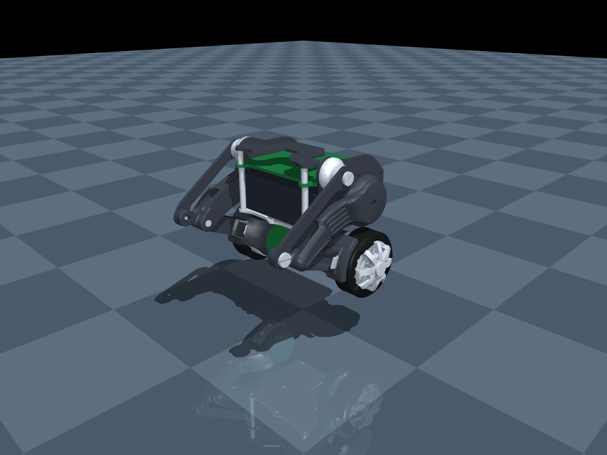
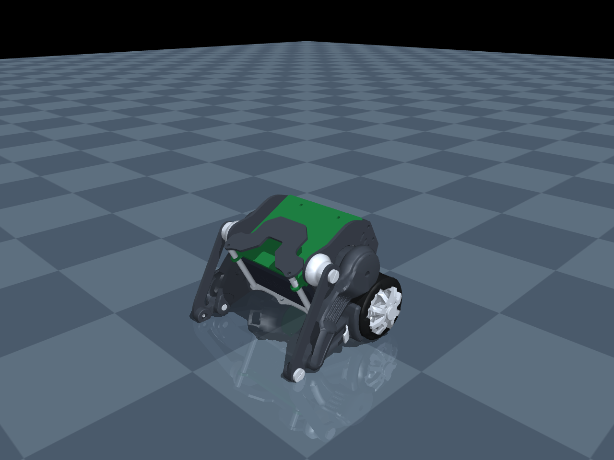

# Micro Wheeled leg Robot MuJoCo変換と実行結果

実施日: 2026年11月7日

`OriginalRobotModel.stp`からロボットの形状と組立配置を取り出し、`Micro-Wheeled_leg-Robot-mujoco-sim/`にMuJoCoモデルと実行スクリプトを作成した。左右の脚リンクと車輪が動作し、胴体固定モードと自由運動モードで各10秒、10,000ステップのシミュレーションが完了した。両モードともMuJoCoの物理計算警告は0件だった。

形状と関節支点はCAD由来だが、質量・慣性・摩擦・駆動特性は仮設定である。今回確認した範囲は形状変換、リンク機構の動作、重力・床接触であり、自立走行や実機に対する動力学精度は未検証である。

## 変換元と実行環境

| 項目 | 内容 |
| --- | --- |
| 元CAD | `external/Micro-Wheeled_leg-Robot/1.RobotModel/OriginalRobotModel.stp` |
| 元リポジトリ | [MuShibo/Micro-Wheeled_leg-Robot](https://github.com/MuShibo/Micro-Wheeled_leg-Robot) |
| 元リポジトリのコミット | `19a012ec8ee8b4f981aab887409a64b8dff37725` |
| 元CADのSHA-256 | `4715cf940718af95872bd2a771fdde61de3376bb748936e2299f94fa76416947` |
| Python | 3.14.4、既存の`myenv/`を使用 |
| MuJoCo | 3.15.0 |
| CAD変換ライブラリ | cadquery-ocp 8.0.1.1.0 |
| 積分・拘束解法 | implicitfast、Newton、タイムステップ0.001秒 |
| 画像出力 | EGLによるヘッドレスレンダリング、1280 × 960画素 |

全体アセンブリを変換対象とした。別途格納されているCNC加工用の個別STEPファイルを重複してモデルに追加していない。

## 生成モデル

| 項目 | 結果 |
| --- | --- |
| 形状部品 | 73個 |
| 三角形 | 324,096枚 |
| メッシュ形式 | バイナリSTL、単位m |
| ロボット剛体 | 9個。胴体1、左右それぞれ大腿・小腿・補助リンク・車輪 |
| ヒンジ関節 | 8個。左右それぞれ股・膝・補助リンク・車輪 |
| 閉リンク拘束 | 左右に`connect`を1個ずつ |
| 駆動入力 | 脚位置指令2軸、車輪トルク指令2軸 |
| センサー | ジャイロ、加速度、胴体姿勢クォータニオン |
| 車輪 | CAD半径18.5 mm、衝突円柱の幅13 mm |
| 仮の合計質量 | 0.320 kg |

形状を持たない`3D_PCB_双轮足&SimpleFOC copy copy copy_2023-03-17`の1部品はスキップした。別部品として存在する`ESP32PCB`やエンコーダ基板は形状を変換している。

CAD座標のmmからMuJoCo座標のmへの変換は以下とした。向きはXが前、Yが左、Zが上である。

```text
x = -CAD.x / 1000
y = (CAD.z - 32) / 1000
z = CAD.y / 1000
```

CADの円筒面から同定した主要な支点は以下の通り。表の座標はCADの平面内座標で、各軸はCADのZ方向に平行である。

| 支点 | CAD X mm | CAD Y mm |
| --- | ---: | ---: |
| 脚サーボ出力軸 | -4.79358 | 15.50000 |
| 大腿と小腿の接続軸 | 43.84353 | -3.13950 |
| 胴体側の補助リンク軸 | 12.90107 | 31.71416 |
| 小腿側の補助リンク軸 | 55.05965 | 1.12649 |
| 車輪軸 | -2.89029 | -20.91448 |

左右の部品対応、各剛体の原点、元部品の外接寸法は[変換マニフェスト](../Micro-Wheeled_leg-Robot-mujoco-sim/conversion_manifest.json)に記録した。

## 実行結果

`supported`は胴体を床上65 mmに固定し、左右の脚位置指令と車輪速度目標を周期的に変える機構確認用デモである。`free`は胴体を自由にし、重力と床接触を有効にした。自由運動では脚の位置目標をCAD初期角度0 radに保ち、車輪トルクを0にしている。

| 計測項目 | 胴体固定 supported | 自由運動 free |
| --- | ---: | ---: |
| シミュレーション時間 | 10.000秒 | 10.000秒 |
| 実行ステップ数 | 10,000 | 10,000 |
| MuJoCo物理計算警告 | 0件 | 0件 |
| 最大リンク閉鎖誤差 | 0.267 mm | 0.701 mm |
| 同時接触数の最大値 | 0 | 8 |
| 胴体原点の最低高さ | 65.000 mm | 22.734 mm |
| 左脚角度の最小〜最大 | -0.2152〜0.1724 rad | 0〜0.0872 rad |
| 右脚角度の最小〜最大 | -0.2152〜0.1724 rad | 0〜0.0872 rad |
| 左車輪角度の最小〜最大 | -0.0034〜16.6454 rad | 約0〜1.0981 rad |
| 右車輪角度の最小〜最大 | -0.0034〜16.6455 rad | 0〜1.0981 rad |

リンク閉鎖誤差は、小腿と補助リンクの接続点の世界座標間距離を左右それぞれ計算した最大値である。接触数はMuJoCoの接触点数で、接触した部品数ではない。角度はCADの組立姿勢を0とする。

さらに、両モデルが読み込めること、メッシュ73個・アクチュエータ4個・閉リンク拘束2個であること、初期姿勢の接続点誤差が`1e-10 m`未満であること、小腿慣性の対角成分が正であることを確認した。10秒の記録に対して、胴体固定時の各脚の角度変化幅が0.3 radを超えること、各車輪の角度変化幅が1回転を超えること、自由運動時の接触が存在すること、閉鎖誤差が両モードで1 mm未満であることを検査し、すべて合格した。

計測値の原本: [supported.json](../Micro-Wheeled_leg-Robot-mujoco-sim/results/supported.json)、[free.json](../Micro-Wheeled_leg-Robot-mujoco-sim/results/free.json)。

### 胴体固定デモの10秒後



胴体を固定しているため車輪は床から浮いている。自立状態を表す画像ではない。

### 自由運動の10秒後



倒立制御を行っていないため、床との接触を伴って胴体が傾く。自由運動が数値的に完了したことは、自立性能の確認を意味しない。

### GUI

`simulate.py`でMuJoCoのGUIを起動し、ビューワー初期化完了を確認した。画面には胴体固定デモであることを表示する。起動時にウィンドウ装飾ライブラリ`libdecor-gtk.so`の読み込み警告があったが、装飾なしにフォールバックしてビューワーは動作を継続した。この警告は上表のMuJoCo物理計算警告とは別である。

## 仮設定と適用範囲

| パラメータ | 設定 |
| --- | --- |
| 胴体質量 | 0.210 kg |
| 大腿質量 | 左右各0.014 kg |
| 小腿質量 | 左右各0.021 kg |
| 補助リンク質量 | 左右各0.002 kg |
| 車輪質量 | 左右各0.018 kg |
| 重心と慣性 | 各剛体のCADメッシュを囲む箱の中心と一様箱の慣性で近似 |
| 脚位置制御 | kp=2、kv=0.04、トルク上限±0.25 N m |
| 車輪トルク上限 | ±0.03 N m |
| 股関節可動域 | ±0.45 rad、位置指令は±0.4 rad |
| 衝突形状 | 車輪は円柱、胴体は箱、脚はカプセル |

上記は実測値やモーターメーカー仕様を再現した値ではない。慣性は詳細なCAD質量特性を計算したものではなく、実機に近い動力学評価には置き換えが必要である。

床との衝突のみを有効にしており、ロボット部品同士の自己衝突は計算しない。ばね、配線、バックラッシュも未モデル化である。色は表示用に設定した。既存の`balance-robot-mujoco-sim/`、PSC-ONE、実機ファームウェアとの制御接続は行っていない。

MuJoCoの通常のメッシュ衝突は凸形状として扱われるため、今回の詳細メッシュは表示用とし、接触用に簡易形状を別に定義した。閉リンクは等式拘束で接続した。これらの表現方法は[MuJoCo公式の計算モデル説明](https://mujoco.readthedocs.io/en/stable/computation.html)に基づく。

## 再実行

以下はリポジトリルートで実行する。

```bash
# GUIで脚と車輪の動作確認
myenv/bin/python Micro-Wheeled_leg-Robot-mujoco-sim/simulate.py

# 自由運動と床接触の確認
myenv/bin/python Micro-Wheeled_leg-Robot-mujoco-sim/simulate.py --mode free

# 胴体固定で10秒計算し、画像と計測値を保存
myenv/bin/python Micro-Wheeled_leg-Robot-mujoco-sim/simulate.py --headless --seconds 10 --render Micro-Wheeled_leg-Robot-mujoco-sim/results/supported.png --report Micro-Wheeled_leg-Robot-mujoco-sim/results/supported.json

# 自由運動で10秒計算し、画像と計測値を保存
myenv/bin/python Micro-Wheeled_leg-Robot-mujoco-sim/simulate.py --mode free --headless --seconds 10 --render Micro-Wheeled_leg-Robot-mujoco-sim/results/free.png --report Micro-Wheeled_leg-Robot-mujoco-sim/results/free.json
```

GUIはマウスで視点操作、`R`でリセット、ウィンドウを閉じて終了できる。依存関係とCAD再変換の手順は[シミュレーションのREADME](../Micro-Wheeled_leg-Robot-mujoco-sim/README.md)に記載している。

## 次に必要な作業

自立・走行の評価に進むには、まず実機の部品質量と重心、モーター特性を反映する。その上で胴体姿勢・車輪速度のフィードバック制御を追加し、姿勢復帰、脚の高さ変更、前後進、外乱応答を検証する。狭い姿勢や干渉が問題になる動作では、自己衝突と詳細な接触形状の追加も必要になる。
